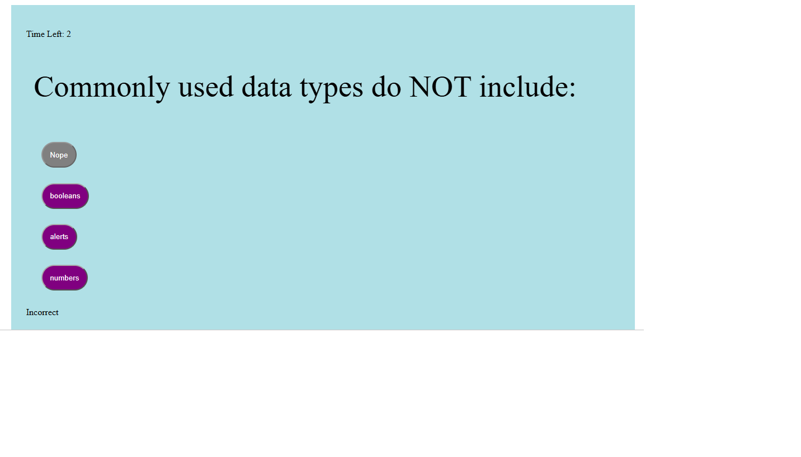
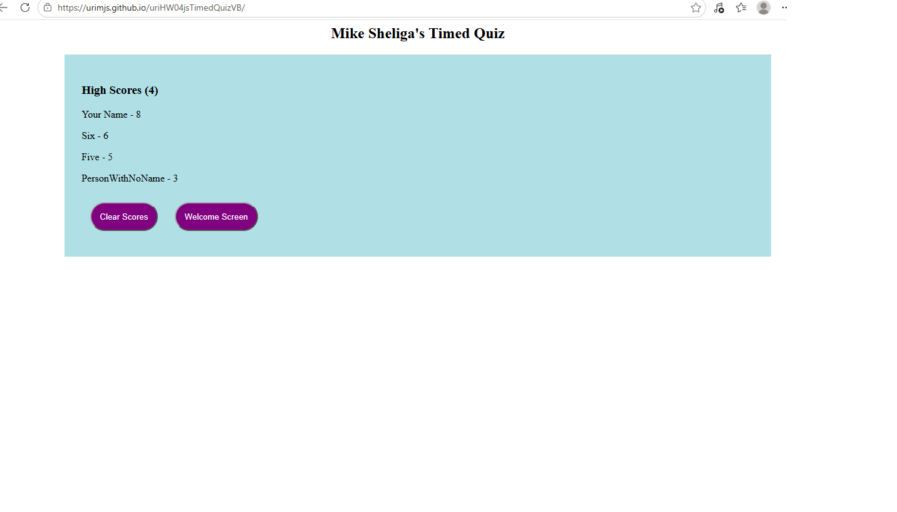

# uriHW04jsTimedQuizVB
Timed quiz using dynamic javascript and timers. MJS 10.14.26

## Links
Deployed HTML Link: "https://urimjs.github.io/uriHW04jsTimedQuizVB/"  
GitHub Repo Link: "https://github.com/uriMJS/uriHW04jsTimedQuizVBjsVB.git"   
Screenshot Question Link:    
Screenshot HiScore Link: 

## Notes
No starter code (index.html, style.css, script.js and a .png file) for this project.   
**All code, including CSS written from scratch.**    
The programming was pretty straight-forward, but long. Lots of adding elements to DOM.   
For the screenshot link: This image seems to only show up in github.  
For screenshot ![Text] is just explanatory text.   
To create githubio  
	- Go to the repo (github.com/uriMJS/uriHW04jsTimedQuizVB).  
	- Click on the **Settings** button.  2nd Row of Icons from top, far right.
	- 

## Acceptance Criteria
    Click the button to generate a password - presented with a series of prompts for password criteria  
    prompted for password criteria - select which criteria to include in the password  
    prompted for the length of the password - choose 8 characters to 128 characters  
    asked for character types to include in the password - confirm whether or not to include lower-uppercase, numeric, and/or special chars  
    I answer each prompt - input should be validated and at least one character type should be selected  
    All prompts are answered - a password is generated that matches the selected criteria  
    The password is generated - and is either displayed in an alert or written to the page.  
	
## Significant Programming Features   
This project was long, with a few tricky bugs.    
**Javascript** Lots of DOM manipulation, much of it common.  
   - document.createElement, Element.appendChild, Button.addEventListener   
   - Element.remove() used to reset main section  
   - "Global" values kept in the DOM (question-index, time-left, Message, interval-id).  
   - intervalId = setInterval(callback method, time)
      - No inner functions since intervalID kept in DOM  
	  - clearInterval(intervalId) in checkAnswer need not be inisde setInterval 
   - Used split(index, length, insertItem) for ordered HiScore list.    
   - **Issue** Buttons displayed in-line, even when inside block or flex-direction column.  
      - Solution: Use a div to surround each button.  
   - Button Click Handler - 4 Methods - onclicks and addEventListener 
      - Documentation at www.xjavascript.com/blog/how-to-set-onclick-with-javascript/   
      - <button onclick="handler(event)"> and button.setAttribute("onclick", "checkAnswer(event)")
         - Note onclick, not onClick  
		 - Both handlers gets quotes, parenthesis and event  
	  - button.onclick = checkAnswer and button.addEventListener("click", handler)  
	     - No handler quotes, parenthesis nor event  
         - addEventListener is only method using "click" instead of "onclick"	
   - **Issue** 		 
 
**CSS**  
   - Multiple button classes (normal and disabled) with different background-colors.  
      - Use to gray out disabled answer. 
   - Class later in CSS controls the color. class="class1 class2" order does not matter.  
 
**To Learn From**  
   - LocalStorage  
     - Used LocalStorage to Keep HiScores  
        - .removeItem, .setItem, .getItem	 
     - Must Store Strings in LocalStorage => JSON.stringify  
     - Need Array out of LocalStorage => JSON.parse  
   - Disabled button with button.setAttribute("disabled", "disabled")  
      - Second values does NOT matter here. 
	  - Use button.removeAttribute("disabled") to enable.
	  - Inconsistent documentation on button.disabled = false;
	  
**Tools (Aint nothing more important than your tools)  
   - Webpage Debugger. CNTL-SHIFT-J  
      - Set breakpoints and inspected variables.  
      - LocalStorage. Found and deletable under Attributes tab.  
   